> _Update (2026): The version used in this post (5.152.2) is an older version and no longer works. Users are now forced to update the app, which fixes the "vulnerability" described here._

# Introduction

Duolingo is one of the most popular language-learning applications in the world, offering more than 100 courses across dozens of languages and reaching over 113 million monthly active users [(1)](https://investors.duolingo.com/news-releases/news-release-details/duolingo-achieves-54-dau-growth-and-40-revenue-growth-third).

While anyone can use the app for free, the free version comes with several limitations compared to the paid tier (Super Duolingo, formerly known as Duolingo Plus):

- Advertisements between lessons
- Inability to freely review mistakes
- Restricted access to specific listening and speaking practice exercises
- Limited "lives" (hearts), meaning that if you make 5 mistakes, you cannot continue your lessons until your hearts regenerate

While using the app, I started wondering how the application validates whether a user has an active Super subscription and whether that validation happens on the server or on the client side. In this post, I will walk through my attempts to analyze the Android app (version `5.152.2`) and unlock its premium features.

# First Attempt

My first idea was to find where the application saves the user's information locally on the device and change my account status directly in that file.

Exploring the application's internal storage directory, I found a JSON file containing the user profile data at the following path:

```bash
/data/data/com.duolingo/files/res/v2/rest/2017-06-30/users
```

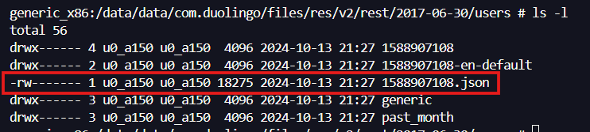{: .align-center}

Opening the `1588907108.json` file, I could see all the user's information stored in plaintext, including the `"hasPlus": false` parameter and the `"health"` object that controls the number of hearts:

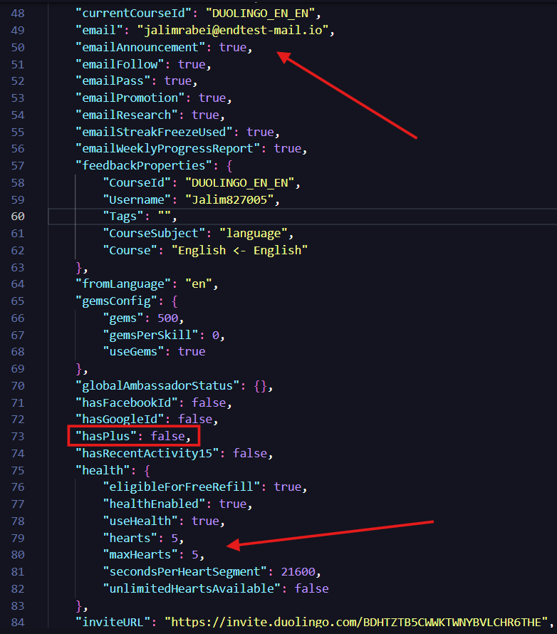{: .align-center}

So, I modified those values, saved the file, and opened the app again, but nothing happened.

The application simply overwrote the file as soon as I opened it. Whenever the app starts, it fetches the user's information from the server and updates the local file. Because of this, it was necessary to intercept and analyze the network requests.

# Second Attempt

The idea now was to intercept the requests made by the app to understand what was happening under the hood. The application itself did not have custom anti-tampering protections, so I used a public Frida script to bypass its SSL pinning restrictions (`TrustManagerImpl` and `OkHTTPv3`).

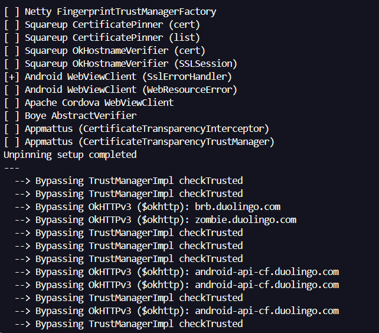{: .align-center}

With the traffic flowing through Burp Suite, I found the request responsible for fetching the user's information:

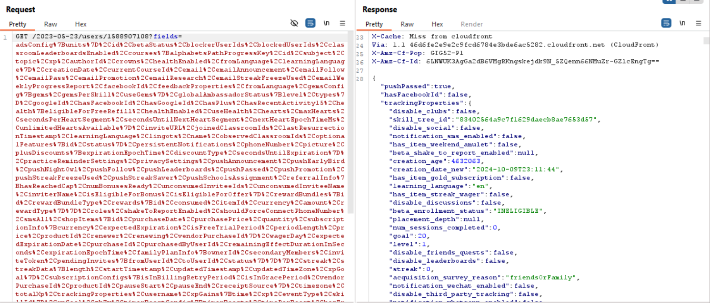{: .align-center}

Looking at the response body, I saw the exact same information that gets written to the local JSON file. To see how the application would handle it, I intercepted the response and changed the `"hasPlus"` parameter from `false` to `true`:

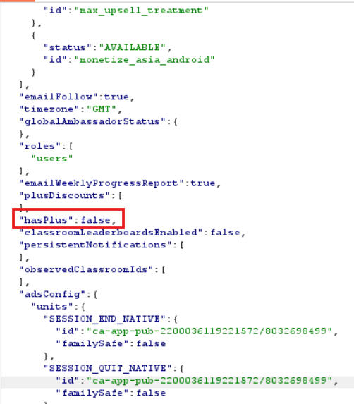{: .align-center}

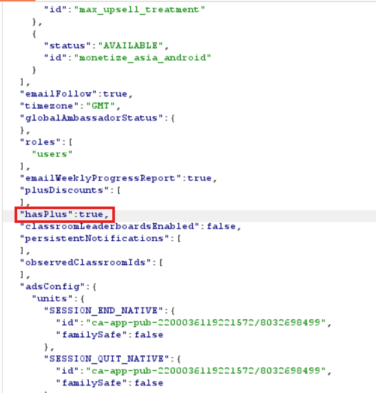{: .align-center}

Because the app makes this same request multiple times while navigating through the interface, changing it manually every time was not practical. To automate this, I configured a Match and Replace rule in Burp Suite to automatically replace `"hasPlus":false` with `"hasPlus":true` in every response body:

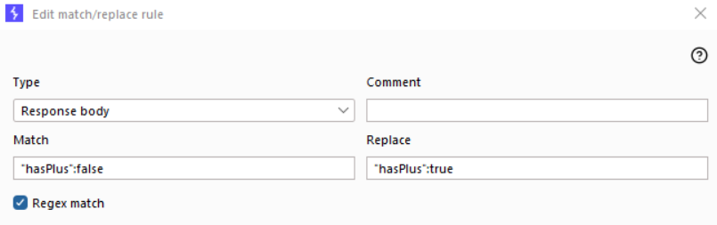{: .align-center}

Then, opening a lesson in the app, I could immediately see the unlimited lives (infinity) symbol in the top right corner:

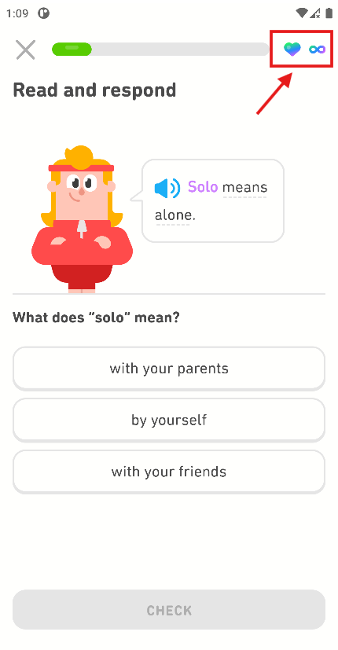{: .align-center}

Okay, the icon changed, but I needed to confirm if it really worked in practice. I started answering the questions, intentionally made more than five mistakes, and confirmed that the lesson continued without deducting any lives.

Cool, it is possible to have a Super account just by modifying the server response. However, I didn't want to depend on a proxy running every time I used the app, so it was time to rewrite the application itself.

# Rewriting the App

The first step to permanently modify the app was to perform reverse engineering on the APK using `apktool` to decompile its resources and `smali` code:

```powershell
java -jar .\apktool_2.7.0.jar d .\Duolingo_5.152.2.apk
```

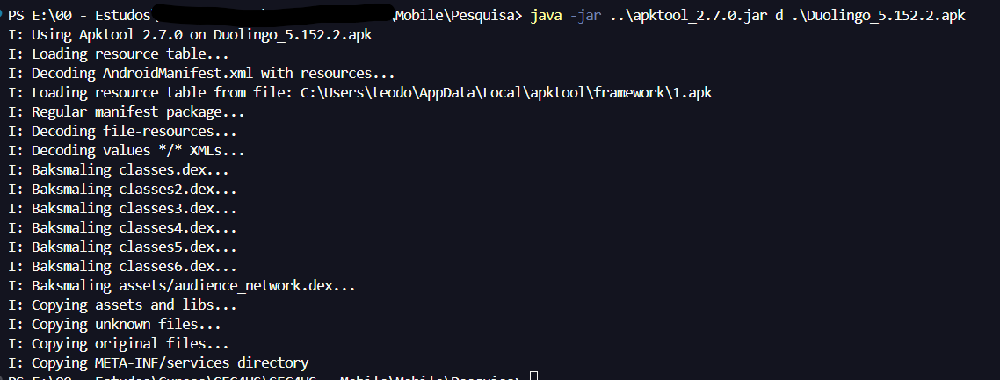{: .align-center}

Once the APK was decompiled, I searched for references to the string `"hasPlus"` across the extracted smali files:

```powershell
grep -rli "hasPlus"
```

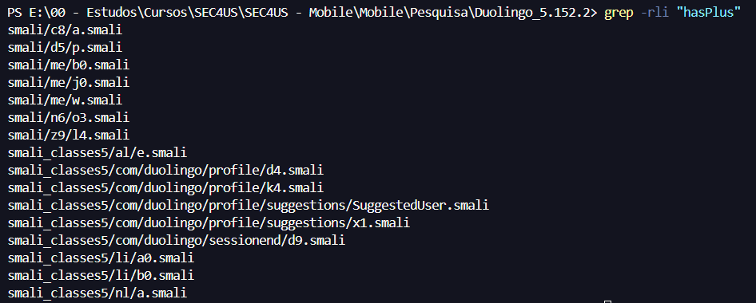{: .align-center}

To make reading the code easier, I also opened the APK in `jadx-gui` and searched for `"hasPlus"`:

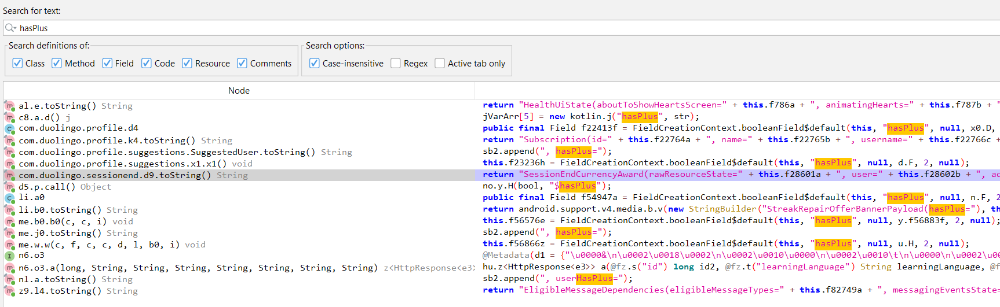{: .align-center}

Analyzing the results, I found that in the class `me.j0`, the app receives the `"hasPlus"` parameter and saves it in the boolean variable `f56676z`:

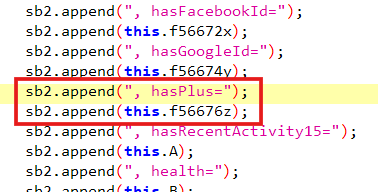{: .align-center}

Further down in the same class, the code checks whether that value is `true`:

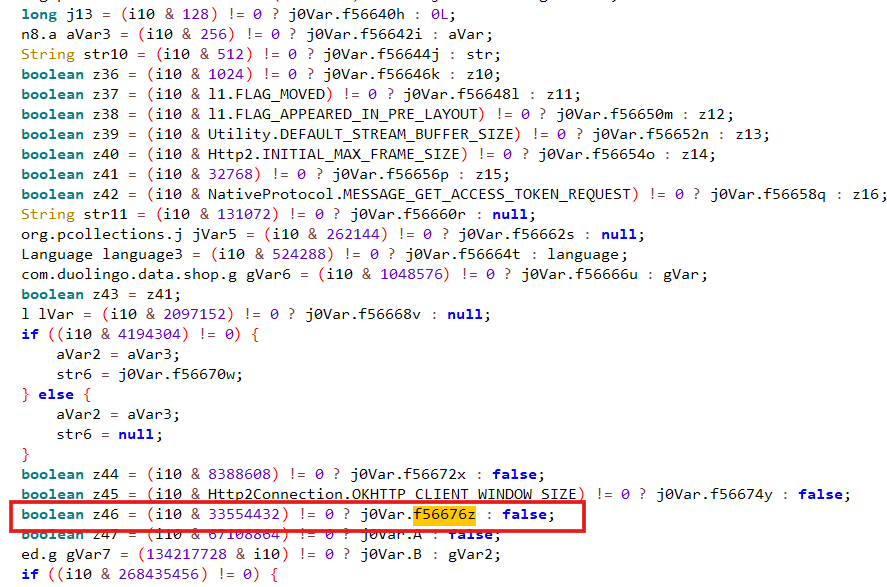{: .align-center}

Notice that the bitwise operation in the decompiled Java code uses the decimal number `33554432`. Since constants in `smali` are represented in hexadecimal, I converted `33554432` to HEX, which resulted in `0x2000000`:

{: .align-center}

Searching the `smali` code of `me/j0.smali` for `0x2000000`, I found the exact routine that checks this flag and reads the boolean field `Lme/j0;->z:Z`:

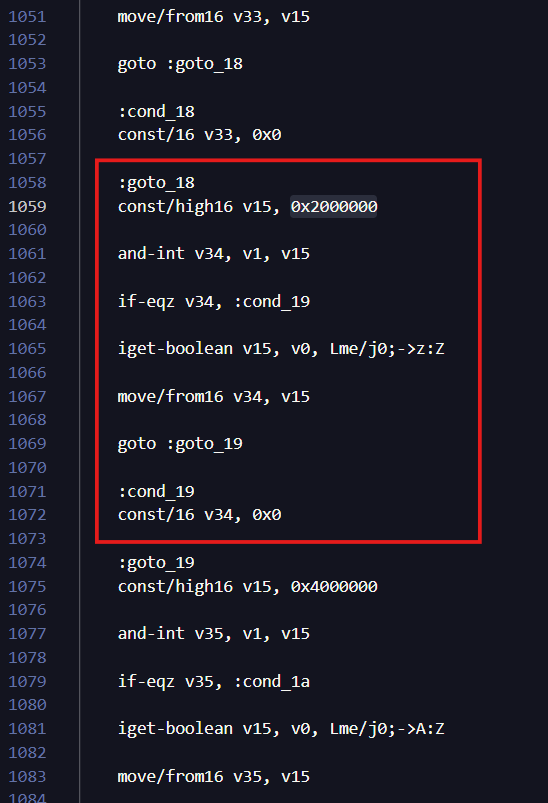{: .align-center}

Then, I changed the instruction at `:cond_19` from `const/16 v34, 0x0` to `const/16 v34, 0x01` so that it always returns `true`, regardless of the server response:

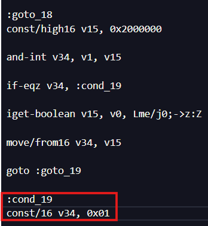{: .align-center}

After that, I searched for all references to this field (`Lme/j0;->z:Z`) across the entire codebase:

```powershell
grep -rli "Lme/j0;->z:Z"
```

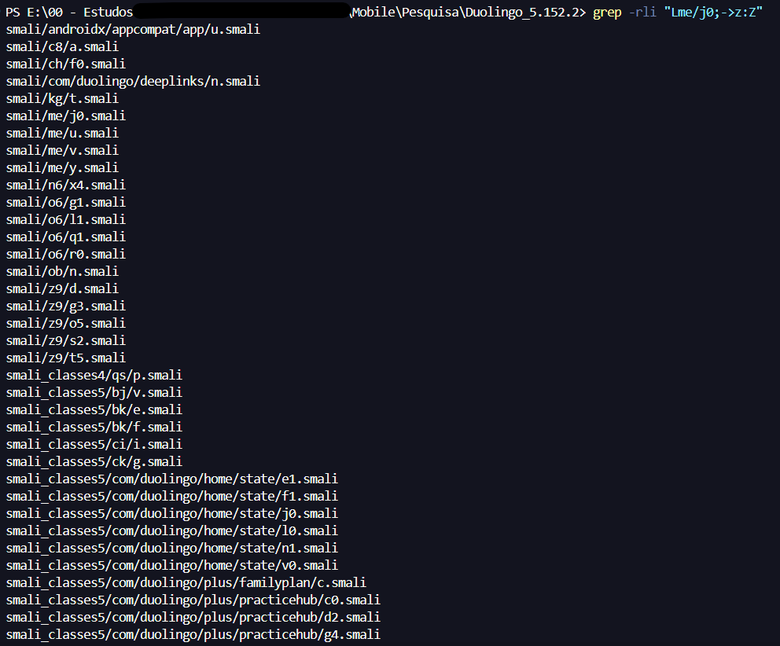{: .align-center}

And that was the boring part: I had to go through all of these files and change the logic so that the response was always treated as `true`.

After modifying all the files, I recompiled the APK using `apktool`:

```powershell
java -jar .\apktool_2.10.0.jar b .\Duolingo_5.152.2\ -o Duolingo_squ4nch.apk
```

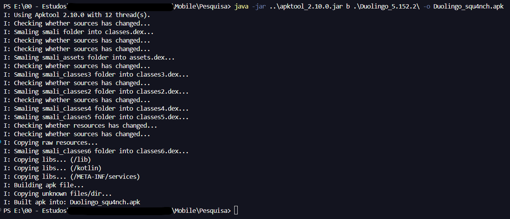{: .align-center}

And then signed and aligned the generated APK using `uber-apk-signer`:

```powershell
java -jar .\uber-apk-signer-1.2.1.jar -a .\Duolingo_squ4nch.apk -o aqui\
```

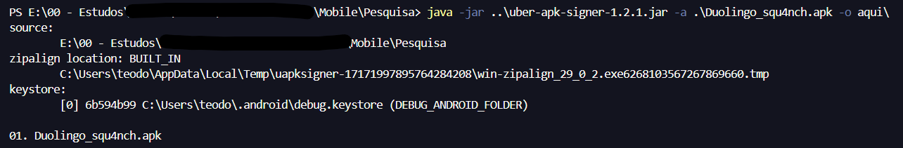{: .align-center}

Finally, after installing and opening the modified app on the device, I could confirm that the premium version was unlocked without needing a proxy:

{: .align-center}

# Conclusion

In this post, we saw how relying on client-side checks to unlock application features can be abused. Even though the Duolingo app overwrote its local configuration file on startup, it still trusted the `"hasPlus"` boolean returned in the HTTP response and stored in the client's memory state.

By combining traffic interception with Frida and Burp Suite to identify how the parameter was handled, and then using `jadx` and `apktool` to patch the `smali` bytecode directly, it was possible to permanently unlock the freemium limitations in that version of the app.

# References

(1) https://investors.duolingo.com/news-releases/news-release-details/duolingo-achieves-54-dau-growth-and-40-revenue-growth-third

(2) https://apktool.org/

(3) https://github.com/skylot/jadx

(4) https://github.com/patrickfav/uber-apk-signer
