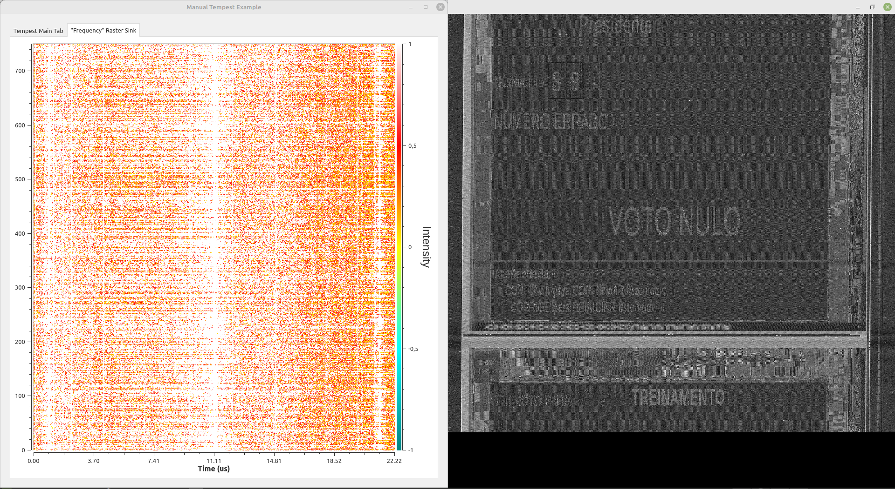

*This work was presented in the Show & Tell Technical Demonstration Session of the IEEE International Conference on Acoustic, Speech, and Signal Processing (ICASSP) 2026, available in https://2026.ieeeicassp.org/industry\_program/#DMOS\_530.*

Authors: Leonardo Teodoro, Kemuel L. Vieira, Saulo Queiroz

# Abstract

In this work, we study the interface of the Brazilian e-Voting Machine (BVM) in the context of electromagnetic side-channel threats commonly referred to as TEMPEST attacks. In a TEMPEST attack against video displays, an eavesdropper uses Software-Defined Radios (SDRs) to recover sensitive information by intercepting electromagnetic emanations generated during video signal transmission. We emulate the BVM using a VGA monitor by leveraging publicly available information disclosed by the electoral authority, including technical specifications, operational rules of the system, and the official BVM interface. Based on this setup, we investigate whether the BVM interface gives rise to a distinctive spectral signature observable through its unintended electromagnetic emissions. Our findings show that design characteristics relevant to a nationwide electoral process – such as high image contrast, minimal on-screen information, and the prohibition of other electronic devices within the polling station – result in a simple and highly distinctive spectral signature that can be observed even through a wall in our experiments. Although our experiments do not involve actual BVM hardware, the results raise concerns regarding the system’s susceptibility to TEMPEST attacks and highlight the need for further research on protective countermeasures. In this context, our findings may support the design of automatic jammers capable of adaptively targeting compromising frequencies. To the best of our knowledge, this is the first study investigating TEMPEST attacks in the context of an electronic voting system officially adopted by a country.

**Index Terms:** Side-channel attack, TEMPEST, Electromagnetic Leakage, e-voting, Brazilian electoral system.

# Description

Wireless side-channel attacks (SCAs) on monitor displays–often referred to as TEMPEST attacks–constitute a class of threats in which an eavesdropper remotely infers sensitive screen information by processing electromagnetic emanations unintentionally emitted by the display. In this demo, we present public TEMPEST, a variant of the TEMPEST threat model in which publicly available system information is leveraged to identify structural signal characteristics _ex ante_, prior to the physical acquisition of electromagnetic leakage. Such pre-characterized properties can both facilitate subsequent side-channel exploitation and support jamming-based mitigation strategies. We illustrate the public TEMPEST concept through a case study based on the Brazilian electronic voting machine.

This research is motivated by a public call issued by the Brazilian electoral authority aimed at anticipating security issues in the electronic voting process and by a recent judicial decision that revoked a councilman’s mandate after identifying the use of micro-cameras to violate voting privacy. We examine how publicly available information about the Brazilian electoral system can expose electronic voting machines to TEMPEST-related SCAs.

We show that key design characteristics of the Brazilian e-voting interface–such as high-contrast images and minimal on-screen information adopted to improve usability for over 150 million electors–result in a highly distinctive spectral signature. Because these interfaces are publicly available, this signature can be analyzed offline and used to support the automatic tuning of electromagnetic parameters that vary across different e-voting machine models (e.g., critical harmonic frequencies). Although this raises concerns regarding the system’s susceptibility to TEMPEST attacks, our findings may support the design of automatic jammers capable of adaptively targeting the compromising frequencies. To the best of our knowledge, this is the first study in the literature about TEMPEST attacks in the context of an electronic voting system officially adopted by a country.

# The TEMPEST Signal

In TEMPEST attacks, an eavesdropper reconstructs sensitive information from electromagnetic signals unintentionally emitted by the target device [^1], [^2]. In a VGA video system, the emitted continuous-time signal $x(t)$ arises from (approximately) rectangular pulses $$p(t-nT_{p})$$ associated with the pixel intensities $$x[n]$$:

$$x(t) = \sum_{n}^{}x[n]p(t-nT_{p}) \tag{1}$${: #eq-1 }

where the pulse (pixel) duration $$T_{p}$$ relates to the pixel rate $$F_{p}$$ as follows

$$T_{p} = \frac{1}{f_{p}} \text{ }\text{ }\text{ s,} \tag{2}$${: #eq-2 } 

$$F_{p} = P_{x}P_{y}f_{v} \text{ }\text{ }\text{ pixels/s} \tag{3}$${: #eq-3 }

and $$P_{x}$$, $$P_{y}$$ and $$f_{v}$$ represent the number of pixels per line (including blanking pixels), the number of lines per frame, and the frame rate, respectively. The Fourier transform of the leaked signal $$x(t)$$ is given by

$$X(f) = P(f)\sum_{n}^{}x[n]e^{-j2\pi nfT_{p}}\text{ }\text{ }\text{ ,} \tag{4}$${: #eq-4 }

where $$P(f)$$ denotes the spectrum of the pulse-shaping function $$p(t)$$, and $$\sum_{n}^{}x[n]e^{-j2\pi nfT_{p}}$$ is the discrete-time Fourier transform (DTFT) of the pixel sequence $$x[n]$$. Consequently, $$X(f)$$ exhibits spectral replicas centered at frequencies $$f =kf_{p}$$, where $$k$$ is integer and $$f_{p} = \frac{1}{T_{p}}$$. Although the ideal pulse model predicts a sinc-shaped envelope with nulls at several of these frequencies in theory, analog distortion of display electronics and propagation effects cause energy leakage around such harmonics in practice, enabling signal interception at suitable compromising frequencies.

# Open Information as a Side-Channel Attack Enabler

In conventional TEMPEST attacks, the parameters associated with the pixel rate [(3)](#eq-3) must be inferred from the eavesdropped signal [(1)](#eq-1) to allow proper signal resynchronization and image reconstruction. This can be reasonably accomplished by leveraging the typical correlation present in video signals (i.e., across frames, across neighbor pixels) [^3]. However, public systems such as the Brazilian electronic ballot process may, inadvertently, facilitate the accomplishment of different stages of a TEMPEST attack by inadvertently publishing such as hardware technical specifications, operational rules of the system, and the official interface of the e-voting machine. In Table I, we summarize the how some publicly available information can be mapped to a distinctive spectral signature in a TEMPEST attack.

*TABLE I:Public information as enabler of TEMPEST attacks in Public E-voting Screen.*

| Open Information  | Enabling Aspect |  Our Case Study  |
|-------|-----|-------|
| Screen Resolution | Reduced computational complexity for frame rate estimation based on decimated DFT e.g., [^6]. | Technical specifications used in public tenders for manufacturers (models ¡ UE2022) |
| Location of target device | Identification of suitable eavesdropping positions | Polling station |
| Rules forbidding operation of third-party devices | Interference-free target signal | Only e-voting machines operate during an polling station |
| Publication of target interfaces for pedagogical purposes | Facilitates analysis of spectral signature identification | Spectral signatures can be analyzed offline for automatic harmonic identification |
 
# Case Study

In this section, we report the results of SDR-based TEMPEST attacks on a VGA graphic system that emulates the Brazilian e-voting machine inteface. We set the target display to a resolution of $$ 1280\text{ }\text{x}\text{ }720\text{ }\text{@}\text{ }60 $$, in accordance to the technical specifications of the UE2020 e-voting machine model [^4]. Thus, the resulting resolution is $$P_{x}\text{ }\text{x}\text{ }P_{y}@f_{v} = 1650\text{ }\text{x}\text{ }750\text{ }\text{@}\text{ }60$$ including blank pixels [^5]. To eavesdropp the leaked VGA signal, we employed a Ettus USRP B200 set to a sample rate of $$f_{s} = 54\text{ }\text{MS/s}$$ with a conventional digital HD TV antenna and the gr-tempest suit [^7]. The target device and the radio were placed in different rooms separed by a masonry wall.

Fig.[1](#fig-1), shows the GNU Radio QT GUI Time Raster graphic (left) and the corresponding eavesdropped voting interface (right), obtained in our experiments. The raster graphic correspond to the line-by-line DFT of the image obtained from the eavesdropped video signal shown on the right. From the Fig.[1](#fig-1), it is clear the presence of a very strong component centered at the time instant $$11.11\text{ }\mu\text{s}$$. Recalling [(3)](#eq-3) and $$f_{s} = 54\text{ }\text{MS/s}$$, this stems from the fact that only $$\frac{1650}{P}\text{ }\text{x}\text{ }54000000 = 1200$$ samples, out of 1600, are acquired per line due to the fact that radio’s sample rate operate below the pixel rate. Thus, the line duration is $$l_{s} = \frac{1200}{f_{s}} ≈ 22.22\text{ }\mu\text{s}$$. Since the DC bin is shifted to the center of the graphic, corresponding to half duration, its DFT coefficient matches the time instante $$\frac{l_{s}}{2} ≈ 11.11\text{ }\mu\text{s}$$, where the highest energy appears. This identified pattern reveals that the high contrast characteristic of the UE2022 interface remains observable even after crossing a mansory wall.

{: .align-center}{: #fig-1}
*Figure 1:Strong DC component of the Brazilian e-voting user interface (left) and the corresponding eavesdropped ballot (right) captured from a VGA video system mimicking the Brazilian e-voting machine under a TEMPEST attack.*

# Conclusion

In this work, we investigate whether the Brazilian e-voting machine interface gives rise to a distinctive spectral signature observable through its unintended electromagnetic emissions in a TEMPEST attack. We emulate the electoral system with a VGA monitor set according to public available information of the Brazilian electoral system, such as, hardware technical specifications, operational rules of the system, and the official interface of the e-voting machine. Our findings show that design characteristics relevant to a nationwide electoral process – such as high image contrast, minimal on-screen information, and the prohibition of other electronic devices within the polling station – result in a simple and highly distinctive spectral signature that can be observed even through a wall in our experiments. Although our experiments do not involve official e-voting hardware, the results raise concerns regarding the system’s susceptibility to TEMPEST attacks and highlight the need for further research on protective countermeasures. In this context, our findings may support the design of automatic jammers capable of adaptively targeting compromising frequencies. To the best of our knowledge, this is the first study in the literature about TEMPEST attacks against an electronic voting system officially adopted by a country.

# Acknowledgements

This work has been partially funded by the project Advanced Multimodal Sensing (AIMS) supported by Advanced Knowledge Center in Immersive Technologies (AKCIT), with financial resources from the PPI IoT of the MCTI grant number 057/2023, signed with EMBRAPII. The authors are also grateful to the “Fundação de Amparo à Pesquisa do Estado de Goiás” (FAPEG) for the financial support provided for this research (Grant 64448878/2024), the “Secretaria de Ciência, Tecnologia e Ensino Superior (SETI)’ and “Fundação Araucária de Apoio ao Desenvolvimento Científico e Tecnológico do Paraná” (call FA 17/2025).

# References

[^1]: M. Ahmed Leghari, S. Mei Pralle, S. F. Peik, S. Luetje, and W. Henkel, “Waveform classification from TEMPEST attacks,” IEEE Access, vol. 13, pp. 167 405–167 423, 2025.

[^2]: E. Lee, D.-H. Choi, T. Nam, I. Kim, Y. Yu, and J.-G. Yook, “Complete coherent demodulation and recovery of spread spectrum clocking-based electromagnetic information leakage: Theory and demonstration,” IEEE Transactions on Information Forensics and Security, vol. 20, pp. 3804–3818, 2025.

[^3]: H. S. Lee, D. H. Choi, K. Sim, and J.-G. Yook, “Information recovery using electromagnetic emanations from display devices under realistic environment,” IEEE Transactions on Electromagnetic Compatibility, vol. 61, no. 4, pp. 1098–1106, 2019.

[^4]: Tribunal Superior Eleitoral, “UE2020 – Technical Security Specifications,” https://www.tse.jus.br/servicos-judiciais/audiencias-publicas/arquivos/ue2020/tse-audiencia-publica-ue2020-especificacoes-tecnicas-seguranca/@@download/file/TSE-audiencia-publica-ue-2020-anexo-4-especificacoes-tecnicas-seguranca.pdf, 2020, annex IV of the public procurement documentation for the Brazilian electronic voting system.

[^5]: Video Electronics Standards Association, “VESA and Industry Standards and Guidelines for Computer Display Monitor Timing (DMT),” Video Electronics Standards Association (VESA), Tech. Rep. Version 1.13, 2013, accessed: 2026-05-22. \[Online\]. Available: https://glenwing.github.io/docs/VESA-DMT-1.13.pdf

[^6]: S. Queiroz, J. P. Vilela, and E. Monteiro, “Fast computation of the discrete fourier transform square index coefficients,” IEEE Signal Processing Magazine, vol. 42, no. 2, pp. 88–92, 2025.

[^7]: F. Larroca, P. Bertrand, F. Carrau, and V. Severi, “gr-tempest: an open-source GNU Radio implementation of TEMPEST,” in 2022 Asian Hardware Oriented Security and Trust Symposium (AsianHOST), 2022, pp. 1–6.

[^8]: Brazilian Superior Electoral Court, “Brazilian Electronic Voting Simulator,” https://www.tse.jus.br/hotsites/simulador-de-votacao/inicioVotacao.html, 2024, official online simulator of the Brazilian electronic voting system. Accessed: 2026-05-23.
